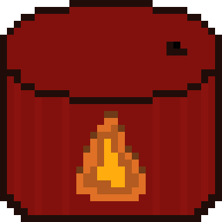
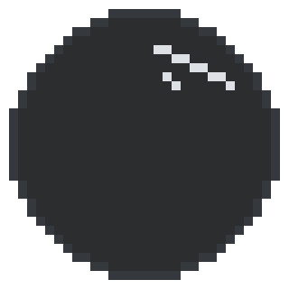
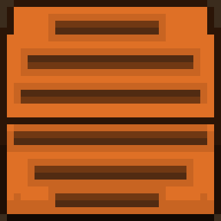
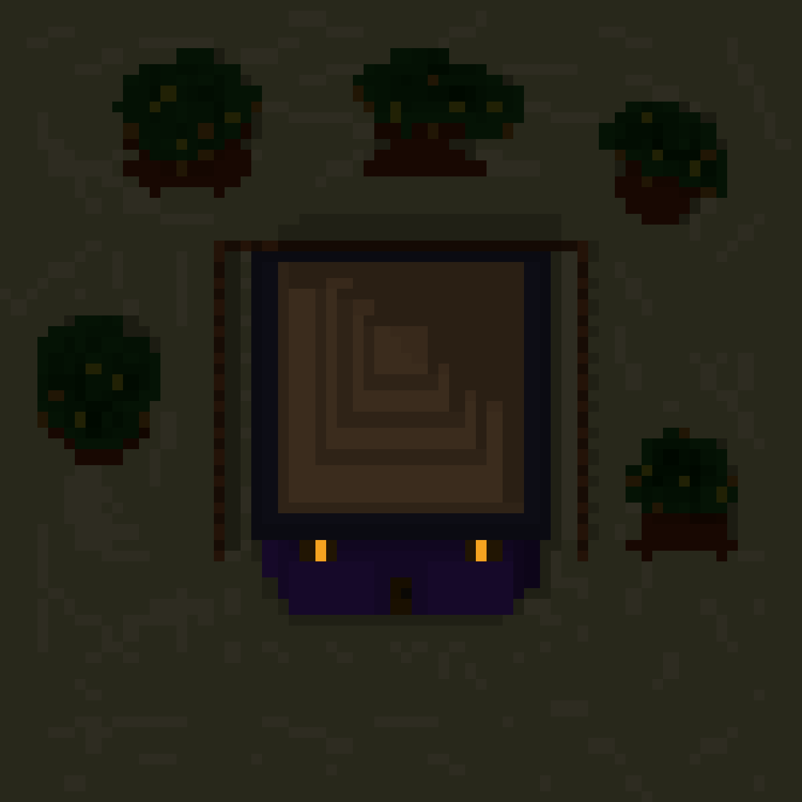
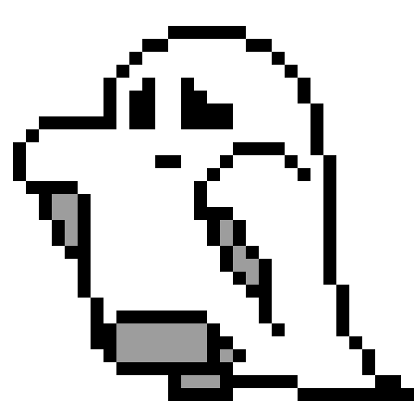
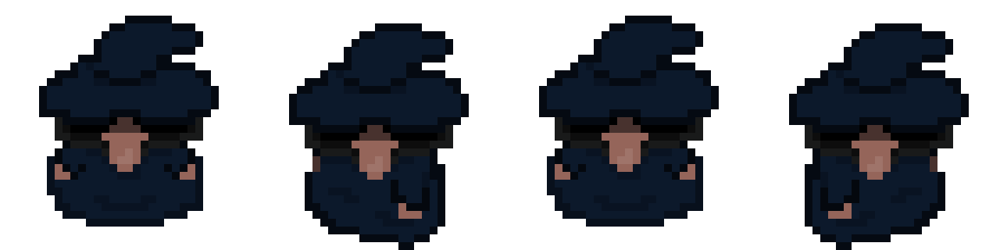
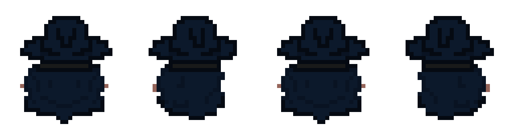
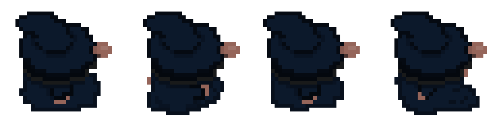
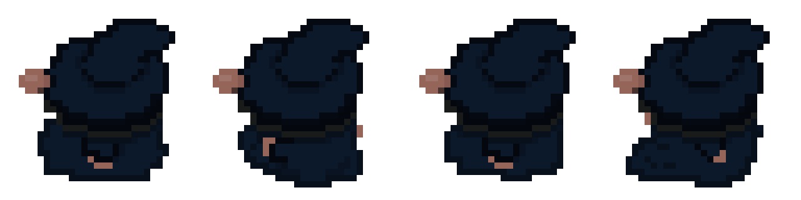

****

**Relatório da Unidade Curricular de Desenvolvimento de Jogos para Plataformas Móveis**

**José Mina nº33200**

**Paulo Pinto nº31474**

**08/01/2026**

**Índice**

**1\. Estrutura do Projeto**

**2\. Funcionalidades do Jogo**

**3\. Desenhos, Esquemas e Protótipos do Jogo**

**4\. Modelo de Dados**

**5\. Implementação do Projeto**

**6\. Tecnologias Usadas**

**7\. Dificuldades Sentidas no Desenvolvimento**

**8\. Melhorias Futuras**

**9\. Conclusões**

**1\. Estrutura do Projeto**

Para o desenvolvimento deste projeto, usamos a linguagem de programação Kotlin no Android Studio. Seguimos o modelo MVVM(Model-View-ViewModel) como arquitetura do projeto que ajuda a manter o código mais organizado, pois este divide em três partes independentes: o Model, responsável pelos dados e a lógica; a View, que mostra a interface gráfica do projeto e por último, o ViewModel onde se trata da comunicação com os dados e a lógica da interface. Seguindo este modelo, torna-se, sobretudo, mais fácil corrigir erros e bugs e testar funcionalidades.

No caso do nosso projeto, os Models são as datas classes User.kt e o Highscore.kt que apenas servem para guardar alguns dados. Os ViewModel são os ficheiros cujo seus nomes incluem ViewModel, em que cada um tem como intuito gerir o estado e a lógica de uma funcionalidade, já as View são as que incluem apenas View no seu nome e têm composables que reagem aos fluxos de dados do ViewModel

Os ficheiros do nosso trabalho encontram-se na pasta com.example.game onde se encontram subdivididos em pastas sendo elas: a pasta Firebase com os modelos de dados, User.kt e Highscore.kt, sendo o primeiro a classe de dados que representa um utilizador registado no jogo e a segunda representa a classe de dados que armazena o melhor score do utilizador e os ficheiros que incluem no nome ViewModel (GameViewModel.kt, HighscoreViewModel.kt, LoginViewModel.kt, ProfileViewMode.ktl, RegisterViewModel.kt ), sendo responsáveis por gerir a lógica do jogo; a pasta ui.theme que tem dentro dela três ficheiros relacionados com o tema e o estilo: Color.kt, para as cores utilizadas no jogo; Theme.kt, para o tema e Type.kt, para a tipografia; a pasta View onde se encontra os ficheiros que têm no nome View (GameOverView.kt, GameScreenView.kt, HighscoreView.kt, HomeView.kt, LoginView.kt, ProfileView.kt e RegisterView.kt) compostas por composables que mostram a suas respetivas interfaces e a componente MyTopBar.kt que fornece a barra de navegação personalizada. A última pasta é a Maingame que contém os ficheiros mais direcionados para as entidades do jogo como o GameView, ou seja, o SurfaceView que renderiza o jogo 2D em tempo real; o Player.kt, a classe que representa o personagem (mago) com que o utilizador joga; a Enemy.kt, a classe que representa os inimigos do jogo; o Projectile.kt, a classe referente aos projéteis disparados pela arma do nosso personagem; a Weapon.kt que representa o sistema de armas do nosso jogador e a CollisionMananer.kt que gere as colisões do jogo.

A MainActivity.kt, ou seja, o activity principal que gere a navegação e a inicialização do jogo, não está em nenhuma subpasta do projeto.

Para além da pasta com os ficheiros de código relativos ao jogo, temos, de igual forma, a pasta drawable com as imagens necessárias para o funcionamento do jogo: as imagens do personagem(mago.png, magobackview.png, magovistalateral.png, magovistalateralesquerda.png), uma para cada direção(esquerda, direita, cima, baixo); a imagem do fundo do jogo(fundo.png); a imagem dos barris(barris.png); a imagem das bombas(bombas.png); a imagem das caixas(caixas.png); a imagem para o highscore(highscoreicon.png); a imagem dos inimigos(inimigo.png); a imagem dos projéteis(licorfireball.jpg); a imagem do botão Play(play.png); a imagem do menu de fundo(menufundo.jpeg). Contudo, algumas das imagens acima não foram utilizadas, pois foram, entretanto, substituídas por outras que satisfaziam melhor os nossos interesses.

Por fim, temos também a pasta raw onde colocamos o som (glass_breaking.mp3).

**2\. Funcionalidades do Jogo**

O nosso projeto apresenta diversas funcionalidades sendo elas: a secção do login e do registo, sendo o primeiro o ponto de contacto do utilizador com o nosso jogo e serve para controlar o acesso ao sistema. Garante que apenas utilizadores apenas registados tenham acesso.

O Login permite que os utilizadores registados acedam ao jogo inserindo as suas credenciais. O jogador ao entrar encontra dois campos de entrada: um para o email e outro para a password, permitindo que o jogador regresse ao jogo sem necessidade de voltar a fazer registo. O sistema valida se os campos estão vazios e proporciona feedback ao utilizador se algum campo estiver em falta. As credenciais são enviadas para a firebase que verifica se o email já existe e se a password é a correta. Se tudo tiver corrido bem, o jogador é automaticamente redirecionado para o menu principal de jogo. Caso contrário, mostra uma mensagem de erro, mas permitindo que o utilizador possa tentar novamente.

O registo permite que novos utilizadores criem uma conta no jogo, sendo lhe apresentado quatro espaços para preencher: nome, email, password e confirmação da password, permitindo assim que qualquer pessoa possa usar o jogo. O sistema faz a verificação se os campos estão todos preenchidos, se o email segue um formato válido, se a password tem um tamanho mínimo e se a password de confirmação é igual à password definida para evitar erros. Se tudo correr bem, a firebase é contactada para criar uma conta nova. Se o email já existir, o firebase emite um erro que é mostrado ao utilizador. Caso a criação tenha corrido bem, um perfil é criado no firestore.

Outra funcionalidade disponível no nosso jogo é o perfil do utilizador, onde pode gerenciar e atualizar as suas informações pessoais armazenadas no jogo, para que possam manter os seus dados atualizados e para que possam ter uma sensação de propriedade sobre a conta. A tela de perfil apresenta três campos que podem ser alterados: o nome, o email e a bio. Quando o utilizador entra nesta tela os dados são automaticamente carregados da firestore, mostrando os dados mais recentes. O utilizador pode atualizar os seus dados quando quiser e quando são alterados eles são comparados com os dados originais e quando isto acontece, aparece um botão save para guardar as informações atualizadas. Clicando no save, os dados são enviados para o firestore e guardados.

O highscore é uma funcionalidade que serve para registar e exibir o melhor desempenho do utilizador no jogo, fazendo com que o jogador ganhe motivação e continue jogando para melhorar o seu resultado, criando um ambiente de competição (contra si próprio). A tela do highscore apresenta o melhor resultado obtido pelo jogador. O ecrã mostra o nome do utilizador e o valor do melhor resultado conseguido. Se o utilizador nunca jogou, o highscore que vai ser mostrado é, obviamente, 0, sendo esta informação sempre atualizada sempre que joga, mas só alterando o valor caso o resultado atual for maior que o resultado guardado no highscore. Caso o jogador consiga um novo highscore, este recebe um feedback positivo na tela de GameOver com a mensagem "NEW RECORD".

A secção do jogo tem vários componentes a trabalhar entre si para garantir uma experiência suave, imersiva e envolvente e para isso contribuem várias funcionalidades implementadas:

Um sistema de controlo (Joystick virtual) para proporcionar um controlo fluido e imersivo, quando o jogador toca na tela aparece o joystick no local do toque onde o sítio do toque define o centro e conforme o utilizador move o dedo enquanto mantém o toque, um círculo mais pequeno segue o dedo. A distância entre o ponto inicial de toque e a posição atual do dedo define o movimento, tendo um raio máximo de 150 pixéis para evitar movimentos descontrolados. O joystick apresenta vantagens em comparação a outras maneiras de controlo do personagem, pois este permite um controlo mais eficiente.

O jogador é representado por um mago animado que aparece próximo do centro da tela. Tem quatro spritesheets, uma para cada direção, permitindo que apareça a olhar para a direção que se está a mover, tornando o movimento do personagem mais realista. Cada spritesheet tem quatro frames de animação para criar a ilusão de andamento. A vida do jogador começa com 100 pontos e decresce 5 pontos sempre que é tocado por um inimigo e quando chega a zero, o jogo termina. A velocidade dele está definida em 5 unidades por frame e o jogador está limitado ao mapa do jogo.

Os inimigos servem para criar desafio no jogo. Há 3 tipos diferentes de inimigos, cada um com características diferentes que os distinguem uns dos outros, sendo que o mais fraco aparece mais no início do jogo e o melhor em fases mais avançadas. Os novos inimigos aparecem continuamente a cada 500 milissegundos. O local do spawn é aleatório num dos quatro lados do mapa (cima, direita, esquerda, baixo), criando variedade e obrigando o jogador a estar atento em todas as direções. O tipo de inimigo que aparece varia consoante o score que o jogador tiver no momento, criando uma curva de dificuldade. Os inimigos calculam sempre a distância para o jogador e movem-se sempre nessa direção, parece simples, mas múltiplos inimigos a moverem-se na direção do jogador causa desafio. Os inimigos desaparecem do mapa imediatamente quando perdem a vida e o jogador recebe mais 10 pontos de score.

O sistema de armas existe para o jogador elimine os inimigos. O jogador tem uma arma que dispara automaticamente sem necessidade de o utilizador fazer algo mais. A arma tem uma cadência de aproximadamente 0,5 segundos na direção para onde o jogador está a olhar. Obriga apenas ao jogador desviar e fugir dos inimigos. Os projéteis são objetos que são disparados pela arma e que andam em linha reta a partir do centro do jogador até colidir com o inimigo ou saírem do mapa, nesse momento são removidos imediatamente.

O sistema de colisões deteta colisões entre as várias entidades do jogo: entre o projétil e o inimigo, ou seja, quando um projétil colide com o inimigo, este último recebe dano. O projétil é removido logo a seguir e se o inimigo morrer, é removido do mapa também; entre jogador e o inimigo, isto é, quando o jogador embate com o inimigo, o jogador perde vida. Se é tocado por múltiplos inimigos então o dano sofrido é múltiplo (5 pontos por inimigo) e entre o projétil e o limite do mapa, acontece quando um projétil sai dos limites do mapa e é removido para economizar os recursos.

O game loop é a estrutura que coordena e mantém o jogo a rodar e serve para coordenar todos os elementos de forma sincronizada e cada frame tem 3 fases: o update (atualização da lógica); o draw (desenhar todos os elementos na tela) e o control (manter a velocidade constante em 60 fps) para garantir um jogo rápido e fluído.

Como funcionalidade, a interface mostra várias informações relevantes para o utilizador para saber como está o estado do jogo: o score, que mostra o número de pontos acumulados; a health, que apresenta a vida restante do jogador; os enemies, mostrando o número de inimigos ativos no mapa naquele moemento e o time, ou seja, os quantos segundos passaram desde o início da partida.

A funcionalidade do fim da partida, ou seja, o game over acontece quando o jogador fica sem vida e serve para encerrar o ciclo da partida e permitir que regresse ao menu principal ou que possa jogar de novo, através da exibição de dois botões, um para jogar de novo (play again) e outro para voltar ao menu (menu). Sendo esta funcionalidade uma tela, apresenta o score que o jogador obteve.

O menu principal é a primeira tela que o jogador vê depois do login bem-sucedido e apresenta quatro botões: o botão Play, que inicia imediatamente uma nova partida; o botão My Highscore, que mostra ao jogador o melhor resultado obtido; o botão Profile, que apresenta a tela com as informações do perfil do utilizador e o botão Logout para encerrar a sessão do utilizador no firebase.

A última funcionalidade aqui apresentada é o sistema de navegação que é responsável por permitir navegar de forma suave entre os vários ecrãs, sendo sete (login, home, register, profile, highscore, game, gameover). O sistema de navegação varia consoante o estado da autenticação e tem como recurso a back stack que permite que o utilizador volte atrás nas telas pressionando o botão voltar do Android.

**3\. Desenhos, Esquemas e Protótipos do Jogo**

Para o desenvolvimento do nosso jogo, nós recorremos ao Piskel para realizar alguns protótipos dos objetos e cenários necessários para o funcionamento do jogo: o barril, a bomba, a caixa, o cenário do jogo, o inimigo e a animação do nosso personagem nas quatro direções (esquerda, direita, cima e baixo). Tendo nós ficado satisfeitos com o resultado de alguns dos protótipos, decidimos usá-los e implementá-los no nosso jogo, nomeadamente, a personagem e o mapa do jogo. Os restantes recursos usados foram retirados de várias fontes da internet.

****
****
****
****
****
****
****
****
****

**4\. Modelo de Dados**

O modelo de dados do jogo foi feito para guardar e gerir três tipos de informação: os dados do perfil dos utilizadores, o histórico do desempenho (Highscore) e o estado das partidas em tempo real. Este modelo foi estruturado utilizando a classe de dados de Kotlin e da Firebase Firestore.

A arquitetura do nosso modelo segue um padrão cliente-servidor onde o jogo mantém cópias na memória dos dados que precisa e a Firebase Firestore trabalha como um servidor que armazena de forma permanente os dados.

A classe User é uma data classe que representa o utilizador no jogo. Esta classe armazena os dados pessoais de cada jogador durante a sessão no jogo.

A classe apresenta quatro campos. O primeiro é o docId, que é do tipo string e guarda o identificador único do utilizador que é gerado de forma automática pela Firebase Authentication quando a conta do utilizador é criada. Assim, este campo é importante pois serve como a chave primária que identifica cada utilizador. O segundo campo é o name, que é do tipo string e guarda o nome do utilizador escolhido pelo jogador durante o registo. Um utilizador tem de obrigatoriamente de preencher este campo e é utilizado como identificação na interface do jogo. O terceiro campo é o email, que é também do tipo string e armazena o endereço eletrónico único do utilizador. O email é de preenchimento obrigatório e tem de seguir um formato válido. O email é fundamental visto que é usado como credencial para o login, juntamente com a password. Não existe dois utilizadores com o mesmo email pois o sistema utiliza-o como um identificador para encontrar e autenticar os utilizadores. O quarto e último campo é a bio, que é do tipo string e armazena uma descrição pessoal dos jogadores. Diferente dos restantes campos, este pode estar vazio, não necessita de estar preenchido e, portanto, pode conter valor nulo. Este campo serve apenas para personalização do perfil.

Quando um utilizador se regista no jogo, uma instância do User é criada com os dados fornecidos, que depois é guardada no Firestore sob a coleção "Users" utilizando o docId como a chave do documento.

A data classe Highscore representa o melhor score obtido pelo jogador em toda as suas tentativas no jogo. Esta classe é separada da User porque os dados são conceitualmente distintos entre as duas classes.

A classe Highscore contém três campos principais. O primeiro é o userId, que é do tipo string e armazena o identificador único do utilizador a quem pertence a este score. O userId é igual ao docId, criando uma ligação entre o score e o utilizador. Este campo é obrigatório e serve como a chave no Firestore. O segundo campo é o username, que é do tipo string e guarda e o nome do utilizador quando o score foi registado pela última vez. O terceiro campo é o score, sendo do tipo integer e armazena o valor numérico do melhor score alcançado. Este é o campo mais importante desta classe, pois representa a métrica do desempenho do jogador. Este valor é usado como comparação quando o jogo termina: se o novo score é maior que o valor guardado no Highscore, o Firestore é atualizado com o novo valor.

Quando um utilizador completa a sua primeira partida e ainda não existe um documento Highscore, um novo é criado com o userId, username e o score igual ao da partida. Nas partidas seguintes, o score é sempre comparado com o highscore existente para verificar se existe um novo recorde ou não.

Durante o funcionamento do jogo, as instâncias das duas classes são mantidas na memória na thread principal do jogo ou nas ViewModels. As instâncias do User são carregadas do Firestore quando o utilizador faz login e são mantidas acessíveis. As instâncias do Highscore são carregadas do Firestore quando o utilizador visualiza a tela do highscore ou quando uma partida termina.

A GameViewModel é uma classe que gere o estado da partida do jogo. Ao contrário do que acontece com as outras duas classes em que os dados são persistidos no Firestore, aqui é mantido apenas em memória durante a duração da partida. Significa que é criado quando inicia uma partida e destruído quando termina, para garantir que uma partida não interfira com as restantes. A GameViewModel utiliza o StateFlow para cada aspeto do estado do jogo e que permite à interface do utilizador observar mudanças de estado e recompor quando os valores mudam como acontece para a pontuação acumulada, a saúde do jogador, o tempo decorrido, o número de inimigos ativos, o indicador do final da partida, o score do final da partida e o indicador do novo recorde. Depois, é chamada a função resetGame() que reinicializa os valores todos para o estado inicial.

Embora o GameViewModel mantenha o estado em memória durante o funcionamento, quando a partida termina, os dados relevantes são persistidos no Firestore.

**5\. Implementação do Projeto**

No processo de implementação do projeto, nós começamos por colocar nas devidas pastas os recursos a ser incluídos no código para o seu funcionamento, como as imagens e o som.
Definimos, também, as classes dos dados que representam a estrutura da informação do jogo. No ficheiro User.kt criamos a classe User com os já ditos campos:
```kotlin
data class User (
    var docId : String? = null,
    var name : String? = null,
    var email : String? = null,
    var bio : String? = null
)
```
e procedemos, da mesma maneira, para a classe Highscore:
```kotlin
data class Highscore(
    val userId: String = "",
    val username: String = "",
    val score: Int = 0
)
```
Foi criado estas duas classes separadamente, em vez de ter o score dentro do User, para que se possa atualizar os dados de um sem afetar o outro.
Depois, criamos o LoginViewModel.kt que contém uma data class interna denominada LoginState, com os campos email, password, error e loading e são inicializados com os valores padrão (não está a decorrer qualquer operação):
```kotlin
data class LoginState(
    var email : String = "",
    var password : String = "",
    var error : String? = null,
    var loading : Boolean = false
)
```
A classe mantém um mutableStateOf(LoginState()), permitindo que o estado seja observado pela interface e alterado sempre que haja mudanças:
```kotlin
class LoginViewModel : ViewModel() {
    var uiState = mutableStateOf(LoginState())
        private set
```
A função onChangeEmail(email: String) é chamada sempre que algo é escrito e para atualizar o email sem alterar os restantes utilizamos state.value = state.value.copy(email = email):
```kotlin
fun onChangeEmail(email : String) {
    uiState.value = uiState.value.copy(
        email = email,
        error = null
    )
}
```
Assim, garante que o estado permanece imutável e previsível e uma validação local é sempre feita antes de chamar a Firebase. A função login(onSuccess: () -> Unit) começa por validar os dados introduzidos:
```kotlin
fun login(onLoginSuccess : () -> Unit) {
    uiState.value = uiState.value.copy(
        loading = true
    )

    if (uiState.value.email.isEmpty()) {
        uiState.value = uiState.value.copy(
            error = "Email is required",
            loading = false
        )
        return
    }

    if (uiState.value.password.isEmpty()) {
        uiState.value = uiState.value.copy(
            error = "Password is required",
            loading = false
        )
        return
    }
```
e caso a validação corra bem procede-se à chamada do Firebase.auth.signInWithEmailAndPassword(email, password):
```kotlin
val auth = Firebase.auth

    auth.signInWithEmailAndPassword(
        uiState.value.email,
        uiState.value.password)
```
O método addOnCompleteListener(task) é usado para receber o resultado da autenticação:
```kotlin
.addOnCompleteListener { task ->
            if (task.isSuccessful) {
```
Se este processo for concluído com sucesso, a função onSuccess() é executada:
```kotlin
               uiState.value = uiState.value.copy(
                    loading = false,
                    error = null
                )
                onLoginSuccess()
```
Senão, é apresentado ao utilizador a mensagem de erro devolvida pelo Firebase:
```kotlin
            } else {
                uiState.value = uiState.value.copy(
                    error = task.exception?.message,
                    loading = false
                )
            }
        }
}
```
Seguidamente, passamos para a criação do RegisterViewModel, onde é definido o RegisterState com os campos name, email, password, confirmPassword, error e loading:
```kotlin
data class RegisterState(
    var name : String = "",
    var email : String = "",
    var password : String = "",
    var confirmPassword : String = "",
    var error : String? = null,
    var loading : Boolean = false
)
```
Tem um mutableStateOf(RegisterState()) para que o estado possa ser observado e a interface seja recomposta quando ocorre uma alteração:
```kotlin
class RegisterViewModel : ViewModel() {
    var uiState = mutableStateOf(RegisterState())
        private set
```
A função register(onSuccess: () -> Unit) executa várias verificações para garantir que os campos estão todos válidos:
```kotlin
fun register(onRegisterSuccess : () -> Unit) {
    uiState.value = uiState.value.copy(
        loading = true
    )

    if (uiState.value.name.isEmpty()) {
        uiState.value = uiState.value.copy(
            error = "Name is required",
            loading = false
        )
        return
    }

    if (uiState.value.email.isEmpty()) {
        uiState.value = uiState.value.copy(
            error = "Email is required",
            loading = false
        )
        return
    }

    if (uiState.value.password.isEmpty()) {
        uiState.value = uiState.value.copy(
            error = "Password is required",
            loading = false
        )
        return
    }

    if (uiState.value.password != uiState.value.confirmPassword) {
        uiState.value = uiState.value.copy(
            error = "Passwords do not match",
            loading = false
        )
        return
    }
```
Quando condições estiverem satisfeitas, dá-se a criação de uma nova conta:
```kotlin
    val auth = Firebase.auth
    val db = Firebase.firestore

    auth.createUserWithEmailAndPassword(uiState.value.email, uiState.value.password)
```
Se a criação da conta foi bem-sucedida, com o identificador do user recém registado é criado um documento no Firestore, contendo os dados do utilizador:
```kotlin
        .addOnCompleteListener { task ->
            if (task.isSuccessful) {
                val firebaseUser = task.result.user
                val userId = firebaseUser.uid

                val user = User(
                    docId = userId,
                    name = uiState.value.name,
                    email = uiState.value.email,
                    bio = ""
                )
```
A operação set(user) grava o documento na base de dados:
```kotlin
                db.collection("users")
                    .document(userId)
                    .set(user)
```
Caso esta operação também seja concluída com sucesso, a função onSuccess() é chamada:
```kotlin                    .addOnSuccessListener {
                        uiState.value = uiState.value.copy(
                            loading = false,
                            error = null
                        )
                        onRegisterSuccess()
                    }
```
Adiante, foi a vez de implementar o ProfileViewModel, com um ProfileState com os campos email, name, bio, error, loading, savedsuccessfully e isModified:
```kotlin
data class ProfileState(
    var name : String = "",
    var email : String = "",
    var bio : String = "",
    var hasChange : Boolean = false,
    var error : String? = null,
    var loading : Boolean = false
)
```
É responsável por gerir o estado associado ao ecrã do perfil do utilizador. A função loadProfile() carrega os dados do utilizador e para isso, obtém primeiro o UID:
```kotlin
fun loadUser(){
    uiState.value = uiState.value.copy(
        loading = true
    )
    val uid = Firebase.auth.currentUser?.uid!!
    val db = Firebase.firestore
```
Com esse identificador, consulta o Firestore e executa a operação get():
```kotlin
    db.collection("users")
        .document(uid)
        .get()
```
Se a leitura for bem-sucedida, o documento é passado para um objeto User, permitindo que se preencha o estado com os dados guardados:
```kotlin
        .addOnSuccessListener { document ->
            val user = document.toObject(User::class.java)
            uiState.value = uiState.value.copy(
                name = user?.name?:"",
                email = user?.email?:"",
                bio = user?.bio?:"",
                loading = false
            )
```
A função updateProfile() é responsável por validar os dados introduzidos pelo utilizador e, caso estejam certos, atualiza o respetivo documento no Firestore:
```kotlin
fun saveChanges() {
    val uid = Firebase.auth.currentUser?.uid!!
    val db = Firebase.firestore

    val user = User(
        docId = uid,
        name = uiState.value.name,
        email = uiState.value.email,
        bio = uiState.value.bio
    )

    db.collection("users")
        .document(uid)
        .set(user)
```
Posteriormente, criamos a HighscoreViewModel onde é definido um MutableStateFlow<Highscore>, responsável por armazenar o estado interno do highscore:
```kotlin
class HighscoreViewModel : ViewModel() {
    private val db = FirebaseFirestore.getInstance()
    private val _highscore = MutableStateFlow(Highscore())
    val highscore: StateFlow<Highscore> = _highscore
```
A função loadHighscore(userId: String) tem como objetivo carregar o highscore do utilizador e ,então, consulta o Firestore:
```kotlin
fun loadHighscore(userId: String) {
    db.collection("highscores").document(userId).get()
```
e quando a operação é concluída, o documento é analisado e são extraídos os valores para score e username:
```kotlin
        .addOnSuccessListener { document ->
            val score = document.getLong("score")?.toInt() ?: 0
            val username = document.getString("username") ?: ""
            _highscore.value = Highscore(userId = userId, username = username, score = score)
        }
```
A função saveHighscore(userId: String, username: String, currentScore: Int) é responsável por guardar o melhor score do utilizador. Antes de atualizar o Firestore, a função obtém o score guardado:
```kotlin
fun saveHighscore(userId: String, username: String, currentScore: Int) {
    val docRef = db.collection("highscores").document(userId)

    docRef.get().addOnSuccessListener { document ->
        val savedScore = document.getLong("score")?.toInt() ?: 0
```
e se o currentScore for superior ao savedScore, é criado um mapa contendo o userId, o username e o novo score:
```kotlin
        if (currentScore > savedScore) {
            val newScore = mapOf(
                "userId" to userId,
                "username" to username,
                "score" to currentScore
            )
```
e este mapa é gravado no Firestore:
```kotlin
            docRef.set(newScore)
            _highscore.value = Highscore(userId = userId, username = username, score = currentScore)
        }
    }
}
```
No seguinte passo, implementamos o GameViewModel que é responsável por gerir o estado do jogo, garantindo que a interface reage às alterações através de StateFlow. É definido um MutableStateFlow para o _score, _health, _timeElapsed, _enemyCount, _isGameOver, _finalScore, _isNewRecord, posteriormente exposto como um StateFlow:
```kotlin
class GameViewModel : ViewModel() {
    private val _score = MutableStateFlow(0)
    val score: StateFlow<Int> = _score
    
    private val _health = MutableStateFlow(100)
    val health: StateFlow<Int> = _health
    
    private val _timeElapsed = MutableStateFlow(0L)
    val timeElapsed: StateFlow<Long> = _timeElapsed
    
    private val _enemyCount = MutableStateFlow(0)
    val enemyCount: StateFlow<Int> = _enemyCount
    
    private val _isGameOver = MutableStateFlow(false)
    val isGameOver: StateFlow<Boolean> = _isGameOver
    
    private val _finalScore = MutableStateFlow(0)
    val finalScore: StateFlow<Int> = _finalScore
    
    private val _isNewRecord = MutableStateFlow(false)
    val isNewRecord: StateFlow<Boolean> = _isNewRecord
```
A função addScore(points: Int) incrementa o valor atual do score:
```kotlin
fun addScore(points: Int) {
    _score.value += points
}
```
A função damagePlayer(amount: Int) reduz a vida do jogador:
```kotlin
fun damagePlayer(amount: Int) {
    _health.value = (_health.value - amount).coerceAtLeast(0)
```
A função updateTime(deltaTime: Long) atualiza o tempo decorrido no jogo, somando o valor recebido:
```kotlin
fun updateTime(deltaTime: Long) {
    _timeElapsed.value += deltaTime
}
```
A função updateEnemyCount(count: Int) atualiza o número de inimigos presentes no ecrã:
```kotlin
fun updateEnemyCount(count: Int) {
    _enemyCount.value = count
}
```
A função endGame() é responsável por finalizar a partida, onde guarda o score final:
```kotlin
fun endGame() {
    _isGameOver.value = true
    _finalScore.value = _score.value
```
e chama a função saveHighScore() que obtém o userId e o username do utilizador do Firebase:
```kotlin
    viewModelScope.launch {
        saveHighScore()
    }
}

private fun saveHighScore() {
    val userId = Firebase.auth.currentUser?.uid ?: ""
    val username = Firebase.auth.currentUser?.email ?: "User"
```
Em seguida, cria uma instância do HighscoreViewModel e envia o score final para o Firestore:
```kotlin
    if (userId.isNotEmpty()) {
        highScoreViewModel.saveHighscore(userId, username, _finalScore.value)
        _isNewRecord.value = true
    }
}
```
Por fim, a função resetGame() reinicializa todos os valores para o estado inicial, permitindo iniciar uma nova partida com os parâmetros padrão:
```kotlin
fun resetGame() {
    _score.value = 0
    _health.value = 100
    _timeElapsed.value = 0L
    _enemyCount.value = 0
    _isGameOver.value = false
    _finalScore.value = 0
    _isNewRecord.value = false
}
```
Posteriormente, criamos o LoginView que é uma composable que mostra o ecrã do login e recebe um navController. Obtém o LoginViewModel com o ViewModel() e observa o uiState com o val uiState by viewModel.uiState:
```kotlin
@Composable
fun LoginView(
    modifier: Modifier = Modifier,
    navController : NavController
){
    val viewModel : LoginViewModel = viewModel()
    val uiState by viewModel.uiState
```
Contém um Text "Login" com um espaço de texto para o email:
```kotlin
    Text("LOGIN", modifier = Modifier.padding(16.dp))
    
    TextField(
        modifier = Modifier.padding(8.dp),
        value = uiState.email,
        onValueChange = {
            viewModel.onChangeEmail(it)
        },
        label = {
            Text("email")
        }
    )
```
e acontece de forma semelhante para a password:
```kotlin
    TextField(
        modifier = Modifier.padding(8.dp),
        value = uiState.password,
        onValueChange = {
            viewModel.onChangePassword(it)
        },
        label = {
            Text("password")
        }
    )
```
O botão Login chama a viewModel.login() e correndo bem a autenticação, avança para o "home":
```kotlin
    Button(
        modifier = Modifier.padding(8.dp),
        onClick = {
            viewModel.login(onLoginSuccess = {
                navController.navigate("home") {
                    popUpTo("login") { inclusive = true }
                }
            })
        },
        enabled = !uiState.loading
    ) {
        if (uiState.loading) {
            CircularProgressIndicator(color = Color.White, modifier = Modifier.padding(8.dp))
        } else {
            Text("Login")
        }
    }
```
Tem um botão "Register", que manda o utilizador para a rota "register", tendo acesso ao ecrã de registo de conta:
```kotlin
    Button(
        modifier = Modifier.padding(8.dp),
        onClick = { navController.navigate("register") }
    ) {
        Text("Register")
    }
```
O RegisterView segue a mesma abordagem, mas inclui quatro campos de entrada: nome, email, password e confirmação de password:
```kotlin
@Composable
fun RegisterView(
    modifier: Modifier = Modifier,
    navController : NavController
){
    val viewModel : RegisterViewModel = viewModel()
    val uiState by viewModel.uiState

    Column(
        modifier = modifier
            .fillMaxSize(),
        horizontalAlignment = Alignment.CenterHorizontally,
        verticalArrangement = Arrangement.Center
    ){
        Text("REGISTER", modifier = Modifier.padding(16.dp))
        
        TextField(
            modifier = Modifier.padding(8.dp),
            value = uiState.name,
            onValueChange = {
                viewModel.onChangeName(it)
            },
            label = {
                Text("name")
            }
        )
        
        TextField(
            modifier = Modifier.padding(8.dp),
            value = uiState.email,
            onValueChange = {
                viewModel.onChangeEmail(it)
            },
            label = {
                Text("email")
            }
        )
        
        TextField(
            modifier = Modifier.padding(8.dp),
            value = uiState.password,
            onValueChange = {
                viewModel.onChangePassword(it)
            },
            label = {
                Text("password")
            }
        )
        
        TextField(
            modifier = Modifier.padding(8.dp),
            value = uiState.confirmPassword,
            onValueChange = {
                viewModel.onChangeConfirmPassword(it)
            },
            label = {
                Text("confirm password")
            }
        )
```
Cada um destes campos está ligado ao estado correspondente no RegisterViewModel, garantindo que qualquer alteração é notada na interface. O botão "Register" chama o viewModel.register(), iniciando o processo de criação da conta e validando os dados transmitidos pelo utilizador:
```kotlin
    Button(
        modifier = Modifier.padding(8.dp),
        onClick = {
            viewModel.register(onRegisterSuccess = {
                navController.navigate("home") {
                    popUpTo("register") { inclusive = true }
                }
            })
        },
        enabled = !uiState.loading
    ) {
        if (uiState.loading) {
            CircularProgressIndicator(color = Color.White, modifier = Modifier.padding(8.dp))
        } else {
            Text("Register")
        }
    }
```
A seguir, passamos para a implementação da HomeView define a Composable responsável por apresentar o menu principal da aplicação móvel:
```kotlin
@Composable
fun HomeView(
    modifier: Modifier = Modifier,
    navController: NavController
) {
```
Funciona como o ponto central da navegação, permitindo ao utilizador aceder às diferentes funcionalidades do jogo. Tem um texto a dizer "GAME MENU", que identifica de forma clara o ecrã:
```kotlin
    Text("🎮 GAME MENU", fontSize = 40.sp, modifier = Modifier.padding(16.dp))
```
Seguem-se vários botões, cada um associado a uma rota específica: o botão "PLAY" encaminha o utilizador para a rota "game", iniciando uma nova partida:
```kotlin
    Button(
        modifier = Modifier.padding(8.dp),
        onClick = { navController.navigate("game") }
    ) {
        Text("PLAY", fontSize = 18.sp)
    }
```
o botão "MY HIGHSCORE" redireciona para a rota "highscore", onde é possível consultar o melhor resultado registado:
```kotlin
    Button(
        modifier = Modifier.padding(8.dp),
        onClick = { navController.navigate("highscore") }
    ) {
        Text("MY HIGHSCORE", fontSize = 18.sp)
    }
```
o botão "PROFILE" conduz para o ecrã de perfil, permitindo visualizar e editar os dados do utilizador:
```kotlin
    Button(
        modifier = Modifier.padding(8.dp),
        onClick = { navController.navigate("profile") }
    ) {
        Text("PROFILE", fontSize = 18.sp)
    }
```
Por fim, o botão "LOGOUT" executa Firebase.auth.signOut(), terminando a sessão atual:
```kotlin
    Button(
        modifier = Modifier.padding(8.dp),
        onClick = {
            Firebase.auth.signOut()
```
e navega para a rota "login", removendo o ecrã inicial da pilha de navegação, garantindo que o utilizador não pode regressar ao menu sem voltar a fazer o login novamente:
```kotlin
            navController.navigate("login") {
                popUpTo("home") { inclusive = true }
            }
        }
    ) {
        Text("LOGOUT", fontSize = 18.sp)
    }
```
Depois, prosseguimos para o ProfileView que representa a visualização e a edição dos dados do perfil do utilizador. A Composable obtém uma instância do ProfileViewModel, garantindo que o estado é gerido de forma consistente:
```kotlin
@Composable
fun ProfileView(
    modifier: Modifier = Modifier,
    navController: NavController,
) {
    val viewModel: ProfileViewModel = viewModel()
    val uiState by viewModel.uiState
```
No interior do LaunchedEffect, é invocado viewModel.loadUser(), permitindo carregar os dados do utilizador assim que o ecrã é apresentado:
```kotlin
    LaunchedEffect(Unit) {
        viewModel.loadUser()
    }
```
A interface contém campos de texto para o nome, o email e a biografia, atualizados através do onValueChange, assegurando que qualquer modificação é realizada:
```kotlin
    TextField(
        modifier = Modifier.padding(8.dp),
        value = uiState.name,
        onValueChange = { viewModel.onChangeName(it) },
        label = { Text("name") }
    )
    TextField(
        modifier = Modifier.padding(8.dp),
        value = uiState.email,
        onValueChange = { viewModel.onChangeEmail(it) },
        label = { Text("email") }
    )
    TextField(
        modifier = Modifier.padding(8.dp),
        value = uiState.bio,
        onValueChange = { viewModel.onChangeBio(it) },
        label = { Text("bio") }
    )
```
Um botão "Save" é mostrado apenas quando uiState.hasChange é verdadeiro, indicando que existem alterações por guardar:
```kotlin
    if (uiState.hasChange) {
        Button(
            modifier = Modifier.padding(8.dp),
            onClick = { viewModel.saveChanges() }
        ) {
            Text("Save")
        }
    }
```
ao ser pressionado, este botão chama viewModel.saveChanges(), armazenando os dados atualizados no Firestore.
O HighscoreView.kt, realizado depois do ProfileView, apresenta a interface da visualização do melhor score do utilizador. Tal como nas outras views, é utilizado um LaunchedEffect para chamar o viewModel.loadHighscore(userId) assim que o ecrã é carregado, garantindo que os dados são obtidos de forma automática:
```kotlin
@Composable
fun HighscoreView(
    viewModel: HighscoreViewModel = viewModel(),
    userId: String = Firebase.auth.currentUser?.uid ?: "",
    navController: NavController
) {
    val highscore by viewModel.highscore.collectAsState()

    LaunchedEffect(userId) {
        viewModel.loadHighscore(userId)
    }
```
A interface mostra um texto identificando o highscore do utilizador, o nome associado ao score:
```kotlin
    Text(
        text = "Highscore de ${highscore.username}",
        style = MaterialTheme.typography.headlineMedium
    )
```
e o respetivo valor:
```kotlin
    Text(
        text = "${highscore.score}",
        style = MaterialTheme.typography.displayLarge
    )
```
O ficheiro MyTopBar.kt é uma Composable que renderiza uma TopAppBar e recebe a topBarTitle, o isHomeScreen e o navController:
```kotlin
@Composable
fun MyTopBar(
    topBarTitle: String,
    isHomeScreen: Boolean,
    navController: NavController
) {
    TopAppBar(
        title = { Text(topBarTitle) },
```
Se !isHomeScreen, exibe um botão "Back" que chama navController.popBackStack() para voltarmos para trás se assim o entendermos:
```kotlin
        navigationIcon = {
            if (!isHomeScreen) {
                IconButton(onClick = {
                    navController.popBackStack()
                }) {
                    Icon(
                        painter = painterResource(R.drawable.caixas),
                        contentDescription = "Back"
                    )
                }
            }
        }
    )
}
```
Posteriormente, criamos a GameScreenView que define uma Composable responsável por integrar o motor do jogo na interface. A view obtém as dimensões do ecrã através do LocalConfiguration:
```kotlin
@Composable
fun GameScreenView(
    modifier: Modifier = Modifier,
    navController: NavController,
    viewModel: GameViewModel
) {
    val configuration = LocalConfiguration.current
    val density = configuration.densityDpi / 160f
    val screenWidthPx = configuration.screenWidthDp * density
    val screenHeightPx = configuration.screenHeightDp * density
```
Em seguida, é criada uma instância da classe Game, que corresponde à View Android onde todo o motor gráfico e lógico do jogo é executado:
```kotlin
    val game = remember {
        Game(
            context,
            screenWidthPx.toInt(),
            screenHeightPx.toInt(),
            viewModel
        )
    }
```
A Composable observa o estado isGameOver exposto pelo GameViewModel; quando este valor se torna verdadeiro, a navegação avança automaticamente para a rota gameOver/${viewModel.finalScore.value}, permitindo apresentar o ecrã do fim do jogo:
```kotlin
    LaunchedEffect(isGameOver.value) {
        if (isGameOver.value) {
            navController.navigate("gameOver/${viewModel.finalScore.value}") {
                popUpTo("game") { inclusive = true }
            }
        }
    }
```
Já o ficheiro GameOverView.kt é a interface apresentada ao utilizador quando a partida termina. A Composable recebe o finalScore, o navController e o viewModel, permitindo mostrar a informação relevante e controlar a navegação:
```kotlin
@Composable
fun GameOverView(
    finalScore: Int,
    navController: NavController,
    viewModel: GameViewModel
) {
    val isNewRecord = viewModel.isNewRecord.collectAsState()
```
O ecrã apresenta o texto "GAME OVER" em vermelho, destacando o fim do jogo:
```kotlin
    Text(
        text = "GAME OVER",
        fontSize = 50.sp,
        color = Color.Red,
        modifier = Modifier.padding(bottom = 20.dp)
    )
```
Caso viewModel.isNewRecord seja verdadeiro, a mensagem que aparece é "🏆 NEW RECORD!" em amarelo, assinalando que o jogador alcançou o seu melhor resultado:
```kotlin
    if (isNewRecord.value) {
        Text(
            text = "🏆 NEW RECORD!",
            fontSize = 30.sp,
            color = Color.Yellow,
            modifier = Modifier.padding(bottom = 20.dp)
        )
    }
```
O score final é mostrado através do texto "Score: $finalScore":
```kotlin    Text(
        text = "Score: $finalScore",
        fontSize = 40.sp,
        color = Color.Black,
        modifier = Modifier.padding(bottom = 40.dp)
    )
```
A interface inclui ainda dois botões: "Play Again", que chama a viewModel.resetGame() e inicia uma nova partida ao navegar para a rota "game":
```kotlin
    Button(
        modifier = Modifier.padding(8.dp),
        onClick = {
            viewModel.resetGame()
            navController.navigate("game") {
                popUpTo("gameOver") { inclusive = true }
            }
        }
    ) {
        Text("Play Again")
    }
```
e "Menu", que redireciona o utilizador para o ecrã inicial através da rota "home":
```kotlin
    Button(
        modifier = Modifier.padding(8.dp),
        onClick = {
            navController.navigate("home") {
                popUpTo("home") { inclusive = false }
            }
        }
    ) {
        Text("Menu")
    }
```
Após os passos anteriores, avançamos para a Game que é o motor do jogo. Esta classe tem o SurfaceView e no construtor recebe o context, as dimensões do ecrã e o viewModel:
```kotlin
class Game(
    context: Context,
    width: Int,
    height: Int,
    private val viewModel: GameViewModel
) : SurfaceView(context), Runnable {
```
no bloco init prepara todos os elementos necessários ao funcionamento do jogo:
```kotlin
    init {
        surfaceHolder = holder
        paint = Paint().apply {
            isAntiAlias = true
            style = Paint.Style.FILL
        }

        val backgroundBitmap =
            BitmapFactory.decodeResource(context.resources, R.drawable.fundo)
        background = Bitmap.createScaledBitmap(backgroundBitmap, width, height, false)

        player = Player(context, width.toFloat(), height.toFloat())
    }
```
O método run() contém o ciclo de jogo, que permanece ativo enquanto isPlaying for verdadeiro e executa, de forma sequencial, as funções update(), draw() e control():
```kotlin
    override fun run() {
        while (isPlaying) {
            update()
            draw()
            control()
        }
    }
```
A função update() concentra toda a lógica do jogo. Começa por calcular o tempo decorrido desde a última atualização:
```kotlin
    fun update() {
        val currentTime = System.currentTimeMillis()
        val deltaTime = currentTime - lastTimeUpdate
        lastTimeUpdate = currentTime
```
e, caso o joystick esteja ativo, determina a direção do movimento do jogador através da normalização do vetor entre a posição do botão e a base do joystick:
```kotlin
        if (isJoystickActive) {
            val dx = joystickKnobX - joystickBaseX
            val dy = joystickKnobY - joystickBaseY
            val distance = Math.sqrt((dx * dx + dy * dy).toDouble()).toFloat()

            if (distance > 0) {
                val directionX = dx / distance
                val directionY = dy / distance
                player.move(directionX, directionY)
            }
```
Se não houver movimento, o jogador permanece parado:
```kotlin
        } else {
            player.stopMoving()
        }
```
Após atualizar a animação do jogador:
```kotlin
        player.update()
```
a câmara é reposicionada com base na sua posição:
```kotlin
        cameraX = player.x + player.frameWidth / 2 - screenWidth / (2f * cameraZoom)
        cameraY = player.y + player.frameHeight / 2 - screenHeight / (2f * cameraZoom)
```
sendo limitada aos limites do mapa:
```kotlin
        val maxCameraX = background.width - width / cameraZoom
        val maxCameraY = background.height - height / cameraZoom
        cameraX = cameraX.coerceIn(0f, maxCameraX)
        cameraY = cameraY.coerceIn(0f, maxCameraY)
```
O tempo de jogo é atualizado no ViewModel:
```kotlin
        viewModel.updateTime(deltaTime)
```
e, a intervalos regulares, são gerados novos inimigos através de spawnEnemy():
```kotlin
        if (currentTime - lastSpawnTime > spawnInterval) {
            spawnEnemy()
            lastSpawnTime = currentTime
        }
```
Cada inimigo desloca-se na direção do jogador:
```kotlin
        for (enemy in enemies) {
            enemy.moveTowardsPlayer(player.x, player.y)
        }
```
e o ViewModel mantém a contagem atualizada:
```kotlin
        viewModel.updateEnemyCount(enemies.size)
```
A arma equipada é atualizada:
```kotlin
        currentWeapon.update()
```
e, consoante a direção do jogador, pode disparar projéteis que são adicionados à lista ativa:
```kotlin
        val (targetX, targetY) = when (player.currentDirection) {
            Player.Direction.DOWN -> Pair(player.x + 50, player.y + 100)
            Player.Direction.UP -> Pair(player.x + 50, player.y - 100)
            Player.Direction.LEFT -> Pair(player.x - 100, player.y + 50)
            Player.Direction.RIGHT -> Pair(player.x + 100, player.y + 50)
        }

        val newProjectile = currentWeapon.shoot(
            player.x + player.frameWidth / 2,
            player.y + player.frameHeight / 2,
            targetX,
            targetY
        )
        if (newProjectile != null) {
            projectiles.add(newProjectile)
        }
```
Cada projétil é atualizado:
```kotlin
        for (projectile in projectiles) {
            projectile.update()
        }
```
e verificado quanto a colisões com inimigos; quando ocorre uma colisão, o inimigo recebe dano, o projétil é removido:
```kotlin
        val collisions = collisionManager.checkProjectileEnemyCollisions(projectiles, enemies)
        for ((projectile, enemy) in collisions) {
            enemy.takeDamage(projectile.damage)
            soundPool.play(glassbreaking, 1f, 1f, 0, 0, 1f)

            projectiles.remove(projectile)
```
e, caso o inimigo seja eliminado, o jogador recebe pontos:
```kotlin
            if (!enemy.isAlive()) {
                enemies.remove(enemy)
                viewModel.addScore(10)
            }
        }
```
Também são verificadas colisões diretas entre os inimigos e o jogador, aplicando dano proporcional ao número de impactos:
```kotlin
        val collidedEnemies = collisionManager.checkPlayerEnemyCollisions(player, enemies)
        if (collidedEnemies.isNotEmpty()) {
            viewModel.damagePlayer(collidedEnemies.size * 5)
        }
```
Se o estado isGameOver no ViewModel for verdadeiro, o ciclo de jogo é interrompido:
```kotlin
        if (viewModel.isGameOver.value) {
            isPlaying = false
        }
    }
```
A função spawnEnemy() determina aleatoriamente um dos quatro lados do ecrã para gerar um inimigo fora da área visível:
```kotlin
    private fun spawnEnemy() {
        val side = (0..3).random()
        val (spawnX, spawnY) = when (side) {
            0 -> Pair((50..screenWidth - 50).random().toFloat(), -50f)
            1 -> Pair((screenWidth + 50).toFloat(), (50..screenHeight - 50).random().toFloat())
            2 -> Pair((50..screenWidth - 50).random().toFloat(), (screenHeight + 50).toFloat())
            else -> Pair(-50f, (50..screenHeight - 50).random().toFloat())
        }

```
O tipo de inimigo criado depende do score atual do jogador, aumentando gradualmente a dificuldade:
```kotlin
        val score = viewModel.score.value
        val enemyType = when {
            score < 100 -> Enemy.EnemyType.GOBLIN
            score < 300 -> {
                if (Math.random() > 0.7) Enemy.EnemyType.ORC else Enemy.EnemyType.GOBLIN
            }
            else -> {
                when ((Math.random() * 3).toInt()) {
                    0 -> Enemy.EnemyType.GOBLIN
                    1 -> Enemy.EnemyType.ORC
                    else -> Enemy.EnemyType.DEMON
                }
            }
        }
```
Após a criação, o inimigo é adicionado à lista ativa:
```kotlin
        val enemy = Enemy(context!!, spawnX, spawnY, enemyType)
        enemies.add(enemy)
    }
```
A função draw() é responsável por desenhar todos os elementos no ecrã. Após garantir que o surfaceHolder está válido, obtém o canvas:
```kotlin
    fun draw() {
        if (surfaceHolder.surface.isValid) {
            canvas = surfaceHolder.lockCanvas()
```
e aplica transformações da câmara:
```kotlin
            canvas.save()

            canvas.scale(cameraZoom, cameraZoom)
            canvas.translate(-cameraX, -cameraY)
```
Em seguida, desenha o fundo:
```kotlin
            canvas.drawBitmap(background, 0f, 0f, null)
```
os inimigos:
```kotlin
            for (enemy in enemies) {
                enemy.draw(canvas)
            }
```
os projéteis:
```kotlin
            for (projectile in projectiles) {
                projectile.draw(canvas)
            }
```
e o jogador:
```kotlin
            player.draw(canvas)

            canvas.restore()
```
Caso o joystick esteja ativo, desenha também a sua base:
```kotlin
            if (isJoystickActive) {
                paint.color = Color.argb(100, 50, 50, 50)
                canvas.drawCircle(joystickBaseX, joystickBaseY, joystickRadius, paint)
```
e o botão de controlo:
```kotlin
                paint.color = Color.argb(200, 80, 80, 80)

                val dx = joystickKnobX - joystickBaseX
                val dy = joystickKnobY - joystickBaseY
                val distance = Math.sqrt((dx * dx + dy * dy).toDouble()).toFloat()

                if (distance > joystickRadius) {
                    val knobX = joystickBaseX + (dx / distance) * joystickRadius
                    val knobY = joystickBaseY + (dy / distance) * joystickRadius
                    canvas.drawCircle(knobX, knobY, 60f, paint)
                } else {
                    canvas.drawCircle(joystickKnobX, joystickKnobY, 60f, paint)
                }
            }
```
Por fim, chama a drawGameUI(canvas) para apresentar informações como o score, a vida, o número de inimigos e o tempo de jogo:
```kotlin
            drawGameUI(canvas)

            surfaceHolder.unlockCanvasAndPost(canvas)
        }
    }
```
Fomos também criando antes das classes da entidade do jogo para depois podermos utilizar e implementar nos outros ficheiros.
O Player define a classe responsável por representar o jogador no jogo. A classe inclui um enum Direction com quatro direções possíveis:
```kotlin
    enum class Direction {
        DOWN, UP, LEFT, RIGHT
    }
```
e várias propriedades relacionadas com a posição, a velocidade, a animação e a colisão:
```kotlin
    var x = 0f
    var y = 0f
    var speed = 5f
    var frameWidth = 64f
    var frameHeight = 64f
    private val totalFrames = 4
    private var currentFrame = 0
    private var frameTicker: Long = 0
    private val spriteSheets = mutableMapOf<Direction, Bitmap>()
    var currentDirection = Direction.DOWN
    var collisionBox: Rect
```
São carregados quatro sprites correspondentes às diferentes direções do jogador:
```kotlin
    init {
        try {
            val originalDown = BitmapFactory.decodeResource(context.resources, R.drawable.mago)
            val originalUp = BitmapFactory.decodeResource(context.resources, R.drawable.magobackview)
            val originalLeft = BitmapFactory.decodeResource(context.resources, R.drawable.magovistalateralesquerda)
            val originalRight = BitmapFactory.decodeResource(context.resources, R.drawable.magovistalateral)

            val newHeight = 64f
            val newWidth = newHeight * totalFrames

            this.frameHeight = newHeight
            this.frameWidth = newWidth / totalFrames

            originalDown?.let { spriteSheets[Direction.DOWN] = Bitmap.createScaledBitmap(it, newWidth.toInt(), newHeight.toInt(), true) }
            originalUp?.let { spriteSheets[Direction.UP] = Bitmap.createScaledBitmap(it, newWidth.toInt(), newHeight.toInt(), true) }
            originalLeft?.let { spriteSheets[Direction.LEFT] = Bitmap.createScaledBitmap(it, newWidth.toInt(), newHeight.toInt(), true) }
            originalRight?.let { spriteSheets[Direction.RIGHT] = Bitmap.createScaledBitmap(it, newWidth.toInt(), newHeight.toInt(), true) }
        } catch (e: Exception) {
            e.printStackTrace()
        }
```
e a posição inicial é definida no centro do ecrã:
```kotlin
        x = screenWidth / 2
        y = screenHeight / 2

        collisionBox = Rect(x.toInt(), y.toInt(), (x + frameWidth).toInt(), (y + frameHeight).toInt())
    }
```
O método move() determina a direção dominante com base no vetor do movimento:
```kotlin
    fun move(dx: Float, dy: Float) {
        currentDirection = if (abs(dx) > abs(dy)) {
            if (dx > 0) Direction.RIGHT else Direction.LEFT
        } else {
            if (dy > 0) Direction.DOWN else Direction.UP
        }
```
e atualiza a posição do jogador, garantindo que permanece dentro dos limites do mapa:
```kotlin
        x += dx * speed
        y += dy * speed

        if (x < 0) x = 0f
        if (y < 0) y = 0f
        if (x > screenWidth - frameWidth) x = screenWidth - frameWidth
        if (y > screenHeight - frameHeight) y = screenHeight - frameHeight

        isMoving = (dx != 0f || dy != 0f)
    }
```
O método update() gere a animação, avançando os frames quando o jogador está em movimento:
```kotlin
    fun update() {
        if (isMoving) {
            frameTicker++
            if (frameTicker > 5) {
                currentFrame = (currentFrame + 1) % totalFrames
                frameTicker = 0
            }
        } else {
            currentFrame = 0
        }
```
e atualiza a caixa de colisão:
```kotlin
        collisionBox.left = x.toInt()
        collisionBox.top = y.toInt()
        collisionBox.right = (x + frameWidth).toInt()
        collisionBox.bottom = (y + frameHeight).toInt()
    }
```
O método draw() seleciona o frame correto do spritesheet:
```kotlin
    fun draw(canvas: Canvas) {
        val startX = currentFrame * frameWidth
        val frameToDraw = Rect(startX.toInt(), 0, (startX + frameWidth).toInt(), frameHeight.toInt())
        val whereToDraw = Rect(x.toInt(), y.toInt(), (x + frameWidth).toInt(), (y + frameHeight).toInt())
```
e desenha o jogador no canvas:
```kotlin
        spriteSheets[currentDirection]?.let { sheet ->
            canvas.drawBitmap(sheet, frameToDraw, whereToDraw, null)
        }
    }
```
A Enemy contém a classe que representa os inimigos. Define o enum EnemyType com três tipos distintos:
```kotlin
    enum class EnemyType {
        GOBLIN, ORC, DEMON
    }
```
cada um com valores próprios de velocidade, vida:
```kotlin
    init {
        when (enemyType) {
            EnemyType.GOBLIN -> {
                speed = 2.5f
                maxHealth = 1
            }
            EnemyType.ORC -> {
                speed = 3.5f
                maxHealth = 2
            }
            EnemyType.DEMON -> {
                speed = 4.5f
                maxHealth = 3
            }
        }
```
e sprite. O bitmap correspondente é carregado:
```kotlin
            try {
                bitmap = BitmapFactory.decodeResource(context.resources, R.drawable.inimigo)
                bitmap = Bitmap.createScaledBitmap(bitmap!!, frameWidth.toInt(), frameHeight.toInt(), true)
            } catch (e: Exception) {
                e.printStackTrace()
            }
```
O método moveTowardsPlayer() calcula a direção do jogador:
```kotlin
    fun moveTowardsPlayer(playerX: Float, playerY: Float) {
        val dx = playerX - x
        val dy = playerY - y
        val distance = sqrt(dx * dx + dy * dy)
        
        if (distance > 0) {
```
e desloca o inimigo nessa direção:
```kotlin
            x += (dx / distance) * speed
            y += (dy / distance) * speed
        }
```
A classe inclui ainda métodos para aplicar dano:
```kotlin
    fun takeDamage(amount: Int) {
        health -= amount
    }
```
verificar se o inimigo continua vivo:
```kotlin
    fun isAlive(): Boolean = health > 0
```
e desenhar tanto o sprite como a barra da vida no canvas:
```kotlin
    fun draw(canvas: Canvas) {
        if (bitmap != null) {
            canvas.drawBitmap(bitmap!!, x, y, null)
        } else {
            // Fallback: desenha retângulo se a imagem não carregar
            val paint = Paint().apply {
                color = when (enemyType) {
                    EnemyType.GOBLIN -> Color.GREEN
                    EnemyType.ORC -> Color.MAGENTA
                    EnemyType.DEMON -> Color.RED
                }
                style = Paint.Style.FILL
            }
            canvas.drawRect(x, y, x + frameWidth, y + frameHeight, paint)
        }
        
        if (health < maxHealth) {
            val healthBarPaint = Paint().apply {
                color = Color.RED
                style = Paint.Style.FILL
            }
            val healthBarBackgroundPaint = Paint().apply {
                color = Color.GRAY
                style = Paint.Style.FILL
            }
            
            canvas.drawRect(x, y - 10, x + frameWidth, y - 5, healthBarBackgroundPaint)
            canvas.drawRect(x, y - 10, x + (frameWidth * health / maxHealth), y - 5, healthBarPaint)
        }
    }
```
Já a Weapon define o enum WeaponType:
```kotlin
enum class WeaponType {
    FIREBALL, LASER, ICE
}
```
e a classe Weapon, responsável por gerir o comportamento da(s) arma(s):
```kotlin
class Weapon(val type: WeaponType, context: Context? = null) {
    var fireRate: Int = 30
    var fireCounter: Int = 0
    var damage: Int = 1
    var speed: Float = 8f
```
O método update() incrementa o contador dos disparos:
```kotlin
    fun update() {
        fireCounter++
    }
```
enquanto o canShoot() verifica se a arma está pronta para disparar:
```kotlin
    fun canShoot(): Boolean = fireCounter >= fireRate
```
O método shoot() calcula o ângulo entre o jogador e o alvo:
```kotlin
    fun shoot(playerX: Float, playerY: Float, targetX: Float, targetY: Float): Projectile? {
        if (canShoot()) {
            fireCounter = 0
            val dx = targetX - playerX
            val dy = targetY - playerY
            val angle = atan2(dy.toDouble(), dx.toDouble()).toFloat()
```
e cria um projétil quando a arma está disponível:
```kotlin
            return Projectile(playerX, playerY, angle, speed, damage, type, projectileBitmap)
        }
        return null
    }
```
O Projectile representa os projéteis disparados pelo jogador. Cada projétil armazena a sua posição, a direção, a velocidade, o dano:
```kotlin
class Projectile(
    val startX: Float,
    val startY: Float,
    val angle: Float,
    val speed: Float = 8f,
    val damage: Int = 1,
    val type: WeaponType = WeaponType.FIREBALL,
    val bitmap: Bitmap? = null
) {
    var posX = startX
    var posY = startY
    val radius = 16f
```
e a caixa de colisão:
```kotlin
    var collisionBox: Rect
    
    init {
        collisionBox = Rect(
            (posX - radius).toInt(),
            (posY - radius).toInt(),
            (posX + radius).toInt(),
            (posY + radius).toInt()
        )
    }
```
O método update() move o projétil em linha reta com base no ângulo calculado:
```kotlin
    fun update() {
        posX += cos(angle.toDouble()).toFloat() * speed
        posY += sin(angle.toDouble()).toFloat() * speed
```
enquanto isOutOfBounds() determina se saiu da área útil do ecrã:
```kotlin
    fun isOutOfBounds(screenWidth: Int, screenHeight: Int): Boolean {
        return posX < -100 || posX > screenWidth + 100 || posY < -100 || posY > screenHeight + 100
    }
```
O método draw() desenha o sprite correspondente:
```kotlin
    fun draw(canvas: Canvas) {
        if (bitmap != null) {
            canvas.drawBitmap(bitmap, (posX - radius).toFloat(), (posY - radius).toFloat(), null)
        } else {
```
ou, na ausência deste, um círculo colorido representativo do tipo de arma:
```kotlin
            val paint = Paint().apply {
                color = when (type) {
                    WeaponType.FIREBALL -> Color.RED
                    WeaponType.LASER -> Color.CYAN
                    WeaponType.ICE -> Color.BLUE
                }
                style = Paint.Style.FILL
            }
            canvas.drawCircle(posX, posY, radius, paint)
        }
    }
```
A CollisionManager contém a lógica de deteção das colisões. A função checkCollision() utiliza o método AABB para verificar interseções entre os retângulos:
```kotlin
    fun checkCollision(rect1: Rect, rect2: Rect): Boolean {
        return rect1.left < rect2.right &&
               rect1.right > rect2.left &&
               rect1.top < rect2.bottom &&
               rect1.bottom > rect2.top
    }
```
A função checkPlayerEnemyCollisions() identifica os inimigos que colidem com o jogador:
```kotlin
    fun checkPlayerEnemyCollisions(player: Player, enemies: List<Enemy>): List<Enemy> {
        val collidedEnemies = mutableListOf<Enemy>()
        for (enemy in enemies) {
            if (checkCollision(player.collisionBox, enemy.collisionBox)) {
                collidedEnemies.add(enemy)
            }
        }
        return collidedEnemies
    }
```
enquanto checkProjectileEnemyCollisions() deteta colisões entre os projéteis e os inimigos, devolvendo um mapa que associa cada projétil ao inimigo atingido:
```kotlin
    fun checkProjectileEnemyCollisions(
        projectiles: List<Projectile>,
        enemies: List<Enemy>
    ): Map<Projectile, Enemy> {
        val collisions = mutableMapOf<Projectile, Enemy>()
        
        for (projectile in projectiles) {
            for (enemy in enemies) {
                if (checkCollision(projectile.collisionBox, enemy.collisionBox)) {
                    collisions[projectile] = enemy
                    break
                }
            }
        }
        return collisions
    }
```
Foi preciso também configurar a Firebase de modo que a pudéssemos usar para o login, o registo e para o armazenamento do highscore. Fizemos os passos recomendados na Firebase, incluindo a adição do ficheiro google-services.json e das dependências necessárias no build.gradle do projeto e do módulo.
À medida que fomos fazendo a implementação do nosso projeto, fomos, de igual forma, adicionando as dependências necessários para o funcionamento correto do jogo como as dependências do Jetpack Compose, as da Firebase e as do suporte, como já referido, e clicando "Sync now", sempre, após a colocação das dependências.
Para finalizar o trabalho, organizamos os ficheiros por pastas com o intuito de organizar e separar os ficheiros de modo que fiquem agregados com semelhanças, num modo geral.

**6\. Tecnologias Usadas**

Para o desenvolvimento do nosso projeto utilizamos algumas tecnologias importantes: a linguagem de programação Kotlin; a framework Android -Jetpack Compose; a Firebase e a Firestore, o SoundPool, o Piskel para desenvolvimento de alguns protótipos usados depois no jogo.

**7\. Dificuldades Sentidas no Desenvolvimento**

Na realização do nosso projeto, defrontamos sempre algumas dificuldades diversas em várias partes do código com alguns bugs e erros, mas podemos afirmar que a maior dificuldade sentida no trabalho foi trabalhar e conectar a Firebase/Firestore por ser um ambiente externo com a qual tínhamos de mexer, para além de termos de seguir alguns passos para a conexão que podem ser facilmente esquecidos.

**8\. Melhorias Futuras**

Apesar de termos um jogo funcional e com várias funcionalidades, não deixa de ser importante notar que há espaço para melhorias e funcionalidades possíveis de ser implementadas de modo a criar uma experiência mais enriquecedora e dinâmica aos utilizadores: Múltiplos tipos de armas com opção de seleção por parte do jogador, pois atualmente o nosso jogo tem apenas a FIREBALL como arma ativa. A classe Weapon.kt define o LASER e o ICE também, contudo não estão a ser usados. Uma melhoria seria permitir ao utilizador selecionar a arma no menu do jogo ou durante a gameplay; um Sistema de Power-ups, ou seja, implementar power-ups que aparecem aleatoriamente no mapa quando os inimigos são destruídos como um HealthBoost, um SpeedBoost ou um AmmoBoost; Leaderboard Global, isto é, um ranking onde mostre, por exemplo, o top 10 jogadores com melhor ranking e adicionar animações com partículas, visto que atualmente quando um inimigo é destruído apenas toca um som e por isso seria importante adicionar uns pequenos círculos que explodem no local do impacto. No fundo, as opções de melhorias são muitas e diversas e nós consideramos estas por acreditarmos que caso fossem implementadas tornariam o jogo mais divertido, dinâmico, envolvente e estratégico.

**9\. Conclusões**

Com este trabalho, conseguimos realizar um projeto do nosso interesse, aplicando os conceitos estudados ao longo da unidade curricular. Para além de que este projeto permitiu-nos aprofundar os conhecimentos da linguagem de programação Kotlin e da Firebase, reforçando as nossas capacidades de construir aplicações móveis.

Ainda assim, temos consciência que conseguimos implementar um trabalho com uma base sólida e propensa a diversas melhorias que poderão ser implementadas no futuro com o objetivo de melhorar a experiência dos nossos utilizadores.
